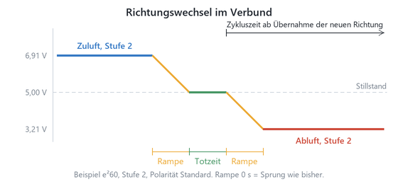

# KNX Lüftersteuerung 0–10 V — Applikationsbeschreibung

Für dezentrale Lüftungsgeräte mit 0–10-V-Stellsignal, entwickelt an LUNOS e²60,
ego und RA 15-60. Vier Stellkanäle S1…S4, bis zu 8 Räume, 12 Lüfter und
8 Verbünde.

Applikation `KwlControl`, Bestellnummer KNXFANDRV.

---

## Bevor Sie anschließen

**5,00 V ist Stillstand. 0 V ist Volllast.** Das Stellsignal der bipolaren Geräte
ist um 5 V herum aufgebaut: unterhalb fördert der Lüfter in die eine Richtung,
oberhalb in die andere, und je weiter von 5 V entfernt, desto schneller. Ein
Stellsignal von 0 V bedeutet **nicht** „aus", sondern volle Drehzahl.

**Nach dem Einschalten der 12 V laufen die Lüfter kurz mit voller Drehzahl.** Die
verwendeten Wandler halten keinen Einschaltwert; die Ausgänge führen 0 V, bis die
Firmware den sicheren Zustand geschrieben hat. Das dauert unter einer Sekunde.
Die Firmware läuft am KNX-Bus, nicht an den 12 V. Kommen die 12 V zu einem
laufenden Gerät, schreibt sie den sicheren Zustand nach höchstens etwa 0,3 s.

> **Liegen 12 V an, ohne dass der KNX-Bus da ist, bleibt es dabei.** Die Lüfter
> laufen dann dauerhaft mit voller Drehzahl. Versorgen Sie die 12 V nicht
> unabhängig vom Bus, oder schalten Sie sie mit.

> **Lüfter erst anschließen, wenn das Gerät mit der ETS programmiert ist.** Ein
> neues Gerät kennt die Lüftertypen noch nicht. Es gibt deshalb an allen Kanälen
> 5,00 V aus: Stillstand für e²60 und ego, aber **halbe Drehzahl für RA 15-60**.
> Der Ablauf steht im nächsten Abschnitt. Denselben Hinweis zeigt die ETS auf der
> Seite *Allgemein* beim Klemmenbild.

**KNX ist kein Sicherheitsbus.** Für den Verbund mit einer Feuerstätte ist
zusätzlich ein fest verdrahteter Kontakt gefordert. Das Objekt „Sperre" ersetzt
ihn nicht.

---

## Erstinbetriebnahme — die Zeit bis zur ETS

Die Firmware wird in der Werkstatt aufgespielt, das Gerät eingebaut und versorgt.
Parametriert wird oft erst Tage später. Für diese Zeit, für den ETS-Download und
für Ausfälle der Versorgung gilt:

| Zustand | Was die Firmware tut | S1…S4 | e²60 / ego | RA 15-60 |
|---|---|---|---|---|
| 12 V an, kein KNX-Bus | läuft nicht | 0 V (Werkswert) | **Volllast** | **Volllast** |
| KNX-Bus an, nie programmiert | schreibt alle 250 ms Bereich und 5,00 V | 5,00 V | Stillstand | halbe Drehzahl |
| 12 V kommen nach dem Bus | wie oben, beim nächsten Durchgang | ≤ ~0,3 s 0 V, dann 5,00 V | kurz Volllast-Signal | kurz Volllast-Signal |
| ETS-Download beginnt | sicherer Zustand, sofort | Stillstand | Stillstand | Stillstand |
| Neustart nach dem Download | sicherer Zustand vor dem Neustart; die DACs halten ihn | Stillstand | Stillstand | Stillstand |
| Nach dem Neustart | Bereich, sicherer Zustand, Totzeit, dann Sollwerte | Betrieb | Betrieb | Betrieb |
| KNX-Bus fällt aus, 12 V bleiben | sicherer Zustand, bevor der Prozessor ausgeht | Stillstand | Stillstand | Stillstand |
| 12 V fallen aus, Bus bleibt | Fehlercode 4, Alarm, LED | — | — | — |
| 12 V kommen zurück | Bereich, sicherer Zustand, Totzeit, dann Sollwerte | ≤ ~0,3 s 0 V, dann Betrieb | kurz Volllast-Signal | kurz Volllast-Signal |
| Falsche Platine gewählt | Fehlercode 3 an allen Lüftern | Stillstand | Stillstand | Stillstand |

„Stillstand“ heißt 5,00 V bei den bipolaren Geräten und 0 V beim RA 15-60. Das
gilt erst, wenn das Gerät den Typ aus der ETS kennt. Vorher nimmt es für jeden
Kanal ein bipolares Gerät an, weil 5,00 V für einen bipolaren Lüfter Stillstand
ist und 0 V Volllast wäre.

Ein „kurzes Volllast-Signal“ bringt einen Lüfter nicht auf Drehzahl. Die Motoren
brauchen deutlich länger als 0,3 s zum Hochlaufen. Das Fenster lässt sich ohne
gespeicherten Einschaltwert nicht schließen, und den gibt es auf dieser Platine
nicht (siehe *Was das Gerät nicht kann*).

**Empfohlener Ablauf beim Einbau:**

1. Gerät einbauen, KNX-Bus und 12 V anschließen. Die Lüfter bleiben abgeklemmt.
2. Physikalische Adresse vergeben, Applikation programmieren.
3. Prüfen: Konsole `kwl st` oder Diagnose-Objekt. Alle Lüfter Fehlercode 0, alle
   Kanäle im Stillstand.
4. 12 V aus, Lüfter anklemmen, 12 V ein.

Ein Gerät, das schon in der Werkstatt programmiert wurde, darf gleich mit Lüftern
eingebaut werden. Dann muss aber der KNX-Bus vor oder mit den 12 V kommen.

---

## Die drei Ebenen

Das Gerät trennt, was oft vermischt wird:

| Ebene | Was sie entscheidet | ETS |
|---|---|---|
| **Raum** | Was gelüftet werden *soll*: Sensoren, Betriebsarten, Bedienung, Führungen | bis 8 Kanäle |
| **Verbund** | Wie zwei oder mehr Lüfter *zusammen* arbeiten: Stufenregel, Takt, Richtung | bis 8, im Lüftermodul |
| **Lüfter** | Wie das Gerät *angesteuert* wird: Typ, Kennlinie, Stellkanal, Kompensation | bis 12 Kanäle |

Ein Lüfter gehört zu genau **einem** Raum und **einem** Verbund. Ein Raum kann
mehrere Lüfter haben, ein Lüfter aber nur einen Raum — und zwei Lüfter im selben
Verbund laufen immer gegenläufig.

**Es müssen nicht zwei Lüfter in einem Raum sein.** Ein einzelner Lüfter im
Schlafzimmer und einer im Flur bilden zusammen einen Verbund: was der eine
hineindrückt, zieht der andere heraus. Die Zuordnung zu Räumen und die zu
Verbünden sind unabhängig voneinander.

---

## Inbetriebnahme in fünf Schritten

1. **Platine wählen** (Seite *Allgemein*). Stimmt die Auswahl nicht mit der
   bestückten Hardware überein, gehen alle Lüfter auf Störung mit Fehlercode 3
   und die Ausgänge bleiben auf 5,00 V. Das ist Absicht: eine verschobene
   Kanalzuordnung stellt den falschen Lüfter auf Vollgas.
2. **Kanäle aktivieren** (Seite *Kanalauswahl*): Räume, Lüfter, Verbünde.
   Jeder Lüfter braucht einen aktiven Verbund; ein allein arbeitender Lüfter
   bekommt einen eigenen.
3. **Je Lüfter** Typ und Stellkanal festlegen, dann Raum, Verbund und Phase.
   Beide Lüfter eines Verbunds brauchen **verschiedene Phasen** (0 und 1) — sonst
   laufen sie gleichsinnig und es gibt weder Luftaustausch noch Wärmerückgewinnung.
   Die **Polarität** (unter *Kennlinie*) legt fest, welche Spannungshälfte Zuluft
   ist. Vorgabe ist über 5 V Zuluft, unter 5 V Abluft, das passt für die
   LUNOS-Lüfter. Umstellen nur für ein Gerät, das es umgekehrt hält.
4. **Je Raum** die Sensoren verknüpfen und die Betriebsarten parametrieren.
   Außentemperatur und Außenfeuchte gelten fürs ganze Haus: verknüpfen Sie sie an
   Raum 1 und stellen Sie bei den übrigen Räumen *von Raum 1 übernehmen* ein.
   Dasselbe gibt es für die Betriebsart, wenn das ganze Haus gemeinsam umschaltet.
5. **Prüfen** über die serielle Konsole: `kwl st`, `kwl r1`, `kwl f1`.

### Balance — der Punkt, an dem Anlagen scheitern

**Zuluft- und Abluftseite müssen sich die Waage halten.** Fördert eine Seite mehr
als die andere, entsteht Über- oder Unterdruck, und der Rest geht durch Fugen,
Fenster und Kamine — an der Wärmerückgewinnung vorbei.

Praktisch heißt das:

- Gleich viele Geräte mit gleicher Stufe je Phase, oder
- den **Anteilsfaktor** (25…100 %) benutzen, wenn die Zahlen nicht aufgehen. Bei
  drei gleichen Lüftern etwa einer voll und zwei zu 50 %.
- Der **ego** zählt für sich: er hat zwei Motoren und pendelt intern, braucht
  also keinen Partner für die Balance — wohl aber, wenn er in Stufe 4 mit beiden
  Motoren Abluft fördert. Dafür gibt es die Zuluftanforderung.

---

## Betriebsarten

Sieben Stück, je Raum getrennt parametrierbar. Vier davon sind KNX-Standard
(DPT 20.102), drei erweitert.

| Wert | Betriebsart | Vorgabe Grundstufe | Vorgabe Maximalstufe |
|---|---|---|---|
| 1 | Komfort | 1 | 4 |
| 2 | Standby | 1 | 2 |
| 3 | Nacht | 1 | **1** |
| 4 | Frost-/Gebäudeschutz | 0 | 1 |
| 5 | Stoßlüften | 4 | 4 |
| 6 | Temperatur-Absenkung | 1 | 2 |
| 7 | Ruhe (Aus) | 0 | 0 |

**Grundstufe** läuft immer, auch ohne jede Anforderung. **Maximalstufe** ist der
Deckel für alle Führungen — der eigentliche Zweck der Betriebsart *Nacht*: im
Schlafzimmer soll auch ein CO₂-Wert über allen Grenzwerten nicht Stufe 4 auslösen.

> DPT 20.102 kennt nur die vier Standard-Betriebsarten. Stoßlüften, Absenkung und
> Ruhe passen dort nicht hinein — dafür gibt es das Objekt *Betriebsart Status
> erweitert* mit den Werten 1…7.

Je Betriebsart lässt sich zusätzlich einstellen, welche Führungen überhaupt laufen
(Temperatur, Feuchte, CO₂, Luftgüte, Entfeuchtung, Frostschutz), welche
Zyklusregel gilt, ob Intervallbetrieb läuft und wie lange der Nachlauf ist.

---

## Die Vorfahrt

Die wirksame Stufe entsteht an **einer** Stelle nach dieser Tabelle. Was weiter
oben steht, gewinnt.

| Rang | Ebene | Wirkung |
|---|---|---|
| 1 | **Sperre** | Stillstand (oder Grundstufe, per Parameter). Gewinnt gegen alles. |
| 2 | **Schutz** (Frost/Hitze) | Schutzstufe. Gewinnt auch gegen Handbedienung. |
| 3 | **Zu-/Abluftanforderung, Betriebsweise** | Erzwingt Richtung, die Anforderung auch die Stufe. |
| 4 | **Verbund** | Slave folgt dem Master. |
| 5 | **Handstufe** | Ersetzt die Automatikstufe. |
| 6 | **Automatikstufe** | Grundstufe, angehoben durch die Führungen, gedeckelt durch die Maximalstufe. |
| 7 | Zwangsobjekt 1 / 2 / 3 | bestimmen, *welcher* Parametersatz |
| 8 | Nacht | in Rang 6 gilt |
| 9 | Zwangsbetriebsart | |
| 10 | Betriebsart | |
| 11 | Standard-Betriebsart | |

**Abweichung vom Arcus-Vorbild:** Dort ist der Frostschutz eine Führung unter
anderen. Hier steht er auf Rang 2 und gewinnt gegen Hand und Verbund — ein
durchfrierender Raum ist kein Bedienfall.

**Die Maximalstufe deckelt die Handstufe nicht.** Sie ist der Deckel für die
Automatik. Wer nachts bewusst Stufe 3 drückt, bekommt Stufe 3.

**Im Verbund gelten Rang 1 bis 3 je Lüfter.** Ein Lüfter im Verbund fährt die
Verbundstufe. Verlangt sein eigener Raum aber Sperre, Schutz oder eine
Zu-/Abluftanforderung, fährt er die Stufe seines Raums. Der Deckel eines
Nachbarraums begrenzt sie nicht. Die Richtung bleibt beim Verbund, damit beide
Lüfter weiter gegenläufig laufen und die Totzeit eingehalten wird. Der
Anteilsfaktor gilt danach für beide Wege gleich. Ein Lüfter mit 50 % fährt bei
*Sperre: Grundstufe* in Stoßlüften also Stufe 2, nicht 4.

### Rücksetzen

Ändert sich ein Objekt der Ränge 5 bis 11, werden alle Ebenen höheren Rangs bis
einschließlich 5 zurückgesetzt. Jede Bedienung bekommt so eine sichtbare Reaktion.
Die Ränge 1 bis 4 sind ausgenommen — eine Sperre lässt sich nicht wegdrücken.

Zwei Beispiele:

- *Auto → Nacht → Zwangsobjekt 1*: Das Zwangsobjekt gilt. Nach Ablauf seiner
  Laufzeit gilt wieder Nacht.
- *Auto → Zwangsobjekt 1 → Nacht*: Die Nacht löscht das Zwangsobjekt. Nach
  Rücknahme der Nacht gilt wieder Auto.

---

## Führungen

Alle Führungen arbeiten über eine **Grenzwert-Treppe**: fünf Grenzwerte für vier
Stufen. Grenzwert *n* schaltet Stufe *n* ein, Grenzwert *n−1* schaltet sie wieder
aus. Die Hysterese ist der Abstand der Grenzwerte und braucht keinen eigenen
Parameter.

| Führung | Vorgaben |
|---|---|
| Relative Feuchte innen | 45 / 50 / 55 / 60 / 65 % |
| CO₂ | 700 / 850 / 1000 / 1300 / 1700 ppm |
| Luftgüte (VOC), ppb | 300 / 500 / 750 / 1000 / 1500 |
| Luftgüte, Index | 100 / 150 / 200 / 300 / 400 |

Es gewinnt die höchste Stufe, die eine Führung verlangt. Die Maximalstufe der
Betriebsart deckelt das Ergebnis.

### Feuchtevergleich

Lüften trocknet nur, wenn die Außenluft weniger Wasser enthält. Verglichen wird
der **Wasserdampf-Partialdruck**, nicht die relative Feuchte: 80 % bei 0 °C sind
trockener als 50 % bei 20 °C.

Liegt der Partialdruck innen um mindestens 1,5 hPa über dem außen, wirkt
Entfeuchten und die Feuchteführung läuft. Unter 0,5 hPa Unterschied wird sie
gesperrt, das Objekt *Feuchtevergleich sperrt* geht auf 1, und es bleibt bei der
Grundstufe. Dazwischen bleibt der letzte Zustand stehen.

> Das ist der Sommer-Kellerfall: innen 18 °C und 75 %, draußen 28 °C und 60 %.
> Gefühlt ist es draußen trockener — tatsächlich steht dort mehr Wasser in der
> Luft, und Lüften würde den Keller feuchter machen.

Ohne gültige Außenwerte bleibt die Feuchteführung gesperrt. Nicht gemessen heißt
nicht entfeuchten.

Zur Anzeige gibt das Gerät die absolute Feuchte innen und außen in g/kg aus. Dafür
— und nur dafür — braucht es den Parameter *Höhe über Meer*.

### Temperaturführung

| Fall | Bedingung | Stufe | Takt |
|---|---|---|---|
| Freie Kühlung | innen > Soll + 1 K, außen kühler als innen − Abstand | „Kühlung" (Vorgabe 3) | Sommer |
| Wärmeerhalt | innen < Soll, außen kühler als innen − Abstand | keine | WRG |
| Warmluft nutzen | innen < Soll − 1 K, außen wärmer als innen + Abstand | „Heizung" (Vorgabe 2) | Sommer |

Der **Temperaturabstand** (Vorgabe 3 K) hält die Führung der Heizungsregelung aus
dem Weg: erst wenn innen und außen weiter auseinanderliegen, greift sie ein.

Das eine Kelvin zwischen den Fällen ist die Hysterese — die Führung hält dort
ihren Zustand, statt zwischen den Takten zu springen.

**Frostschutz** (Vorgabe 8 °C) schaltet die Lüftung ab und gibt erst 2 K über dem
Grenzwert wieder frei. **Hitzeschutz** (Vorgabe 30 °C) greift nur, wenn es draußen
noch wärmer ist — sonst wäre Kühlen ja richtig.

### Fehlende Messwerte

Jeder Sensoreingang hat eine Überwachungszeit. Bleibt der Wert aus, gilt er als
nicht vorhanden, und der Parameter *bei fehlenden Messwerten* entscheidet:
Grundstufe weiterfahren oder Stillstand.

---

## Verbund, Takt und Wärmerückgewinnung

**Die Pendelbewegung *ist* die Wärmerückgewinnung.** Bei Geräten mit Regenerator
gibt es dafür keinen Schalter: der Speicher nimmt die Wärme der Abluft auf und
gibt sie an die Zuluft ab, wenn die Richtung wechselt.

| Zyklusregel | Zykluszeit | WRG | wofür |
|---|---|---|---|
| Wärmerückgewinnung | je Stufe, Vorgabe 70 s | ja | Heizperiode |
| Sommer | Vorgabe 1 h | praktisch nein | Sommer, freie Kühlung |
| über Objekt „Sommer" | schaltet zwischen beiden | | Standard |
| feste Richtung Zuluft/Abluft | kein Wechsel | nein | Sonderfälle |

**Sommerbetrieb ist kein Einrichtungsbetrieb, sondern ein langer Zyklus.** Der
Regenerator ist nach etwa einer Minute gesättigt; bei einer Stunde Zykluszeit
überträgt er praktisch keine Wärme mehr — die Richtung wechselt aber weiter, und
damit gibt es keinen dauerhaften Über- oder Unterdruck und beide Räume bekommen
Frischluft.

**Vor jedem Richtungswechsel** stehen alle Kanäle des Verbunds für die *Totzeit*
(Vorgabe 2 s) auf 5,00 V. Beim ego gilt das für beide Motoren gleichzeitig.

**Rampe beim Richtungswechsel** (je Verbund, Vorgabe 5 s, 0 = aus). Die
Stellspannung geht vor der Totzeit gleichmäßig auf 5,00 V zurück und steigt
danach in der neuen Richtung wieder auf die Stufenspannung. Ein Wechsel dauert
damit Rampe + Totzeit + Rampe, mit den Vorgaben 12 s. Die Zykluszeit zählt ab der
Übernahme der neuen Richtung. Die Rampe gilt nur für Richtungswechsel, auch für
den erzwungenen (Zu-/Abluftanforderung, Betriebsweise). Ein Stufenwechsel in
derselben Richtung springt sofort. Läuft der Verbund aus dem Stillstand an, gibt
es nichts herunterzufahren: dann nur Totzeit und Rampe nach oben. Das Objekt
„Ausgangsspannung“ meldet die Zielspannung, nicht jeden Zwischenwert.

Zusätzlich wacht jeder Kanal selbst über die Totzeit. Wechselt die Spannung die
Seite von 5 V, ohne dass der Verbund die Richtung ändert, steht der Kanal erst
die Totzeit lang auf 5,00 V. Das betrifft den Abluftstoß des ego, bei dem Stufe 4
beide Motoren unabhängig von der Richtung belegt. Es betrifft auch jeden Start
und jede Wiederkehr der 12 V, weil vorher 0 V = Volllast anliegen konnten. Nach
dem Einschalten laufen die Lüfter deshalb erst nach der Totzeit an.

**Ein Lüfter allein.** Auch ein Lüfter, der allein in einem Raum arbeitet,
braucht einen Verbund – einen eigenen, in dem nur er steckt. Der Verbund liefert
Takt, Totzeit und Rampe; die Stufenregel ist mit einem Mitglied belanglos, es
gilt die Stufe des Raums. Die frühere Auswahl „eigenständig“ mit festen Werten
ist am 2026-10-10 entfallen. Zeigt ein Lüfter auf einen Verbund, der nicht
aktiviert ist, warnt die ETS auf der Lüfterseite; die Firmware hält ihn auf
5,00 V und meldet Fehlercode 3.

### Wenn die Räume uneins sind

| Konflikt | Regel |
|---|---|
| Verschiedene Stufenwünsche | Parameter *Stufenregel*: Maximum mit kleinstem Raumdeckel (Vorgabe), Minimum, oder ein Raum führt |
| Verschiedene Zykluswünsche | Parameter: kürzester Zyklus gewinnt (Vorgabe), oder der führende Raum entscheidet |
| Verschiedene Richtungsforderungen | Die höhere Stufe führt; bei Gleichstand die niedrigere Raumnummer. Der unterlegene Raum meldet Fehlercode 11. |

Ein Verbund hat genau **eine** Richtung. Zwei Lüfter darin können nie gleichsinnig
laufen — was in den einen Raum hineingedrückt wird, muss aus dem anderen heraus.

### Master und Slave

Ein Verbund kann über mehrere Geräte gehen. Die Rolle steht je Verbund:

- **intern** — nur Lüfter dieses Geräts,
- **Master** — sendet Stufe, Halbwelle und Lebenszeichen auf den Bus,
- **Slave** — folgt einem fremden Master.

Bleibt beim Slave das Lebenszeichen länger als die Überwachungszeit aus, gehen
seine Lüfter auf Stillstand und melden Fehlercode 2. Er weiß dann nicht mehr, in
welcher Halbwelle der Verbund steht, und Weiterlaufen hieße raten.

Die Verbund-Objekte liegen beim Lüfter mit der **kleinsten Kanalnummer** des
jeweiligen Verbunds.

Auch am Slave gelten Sperre und Schutz des eigenen Raums. Der Master kennt das
offene Fenster in diesem Raum nicht. Ein Slave-Lüfter im Schutz steht still und
meldet Fehlercode 9. Er folgt dem Master dann nicht, und das soll man sehen.

---

## Abluftanforderung — die Badlüftung

Das Objekt *Abluftanforderung* fährt den Raum in Abluft mit der parametrierten
Stufe (Vorgabe 4; beim ego ist Stufe 4 der Abluftstoß beider Motoren).

Im Verbund gilt diese Stufe für die Lüfter des anfordernden Raums, auch wenn ein
Nachbarraum im Verbund gerade auf Standby oder Nacht steht. Die übrigen Lüfter des
Verbunds fahren die Verbundstufe mit dem Deckel des Nachbarn.

- **Vorlaufzeit** (0 s…5 min): erst nach dieser Zeit wird gefördert. Wird die
  Anforderung vorher zurückgenommen, passiert nichts — es gibt keinen Nachlauf für
  eine Lüftung, die nie lief.
- **Nachlaufzeit** (Vorgabe 15 min): danach läuft es weiter.
- **Intermittierend** (etwa 1 min je 5 min): in den Pausen fällt der Raum auf
  seine Automatik zurück, die Grundlüftung läuft also weiter.

Solange Abluft läuft, sendet der Raum eine **Zuluftanforderung**. Verbünde mit dem
Parameter *folgt Zuluftanforderung von Raum n* schalten für die Dauer auf Zuluft —
der ego im Bad zieht 45 m³/h ab, und die muss irgendwo nachströmen, sonst pfeift
es an den Fenstern.

---

## LED und Funktionstaste am Gerät

Die Platine hat **eine** LED und **eine** Taste. Beide wirken aufs ganze Gerät.

**Info-LED** — unter *Allgemein → Info-LED* wählbar:

| Funktion | Verhalten |
|---|---|
| Lüftung | Alarm → Blinkcode des kleinsten anliegenden Codes (so viele Blitze wie der Code, dann Pause). Meldung → langsames Blinken. Sonst an, wenn ein Lüfter läuft. |
| Lüftung, nur Störungen (**Vorgabe** für Info-LED 1) | wie oben, aber dunkel im Normalbetrieb — für den Schlafzimmerflur |

**Funktionstaste** — je Geste wählbar unter *Allgemein → Funktionstaste*:

| Geste | Vorgabe | Wirkung |
|---|---|---|
| kurz | Stoßlüften ein/aus | in allen Räumen, mit der Laufzeit der Zwangsbetriebsart. Nochmal: aus. |
| lang (ab 1 s) | Ruhe ein/aus | alles steht. Nochmal: zurück. |
| doppelt (2 Klicks in 0,5 s) | Filterwechsel quittieren | nur bei Lüftern mit **fälligem** Filter |

Die LED blitzt einmal, wenn eine Geste angekommen ist. Stoßlüften und Ruhe laufen
über die Zwangsbetriebsart — also mit Rücksetz-Semantik und ohne die Sperre
anzufassen.

---

## Kommunikationsobjekte

### Je Raum (Block 40, ab KO 20)

| Nr. | Objekt | Richtung | DPT |
|---|---|---|---|
| 0 | Betriebsart (0 = Automatik, Werte siehe unten). Ab Raum 2 nur sichtbar bei *eigene Kommunikationsobjekte* | Ein | 20.102 |
| 1 | Zwangsbetriebsart, mit Laufzeit, 0 beendet | Ein | 20.102 |
| 2 | Nacht | Ein | 1.003 |
| 3–5 | Zwangsobjekt 1 / 2 / 3 | Ein | 1.003 |
| 6 | Stufe manuell | Ein | **5.100** |
| 7 | Stufe manuell % | Ein | 5.001 |
| 8 | Stufe höher/niedriger | Ein | 1.007 |
| 9 | Handbetrieb aktiv (0 beendet) | Ein/Aus | 1.012 |
| 10 | Sommer | Ein | 1.001 |
| 11 | Betriebsweise (0 auto / 1 WRG / 2 Zuluft / 3 Abluft) | Ein | 5.010 |
| 12 | Abluftanforderung | Ein | 1.003 |
| 13 | Sperre | Ein | 1.003 |
| 14–20 | rF innen, T innen, rF außen, T außen, CO₂, Luftgüte, Solltemperatur | Ein | 9.007 / 9.001 / 9.008; Luftgüte je nach Format 9.008 oder 7.001 |
| 21–24 | Führungen aktiv: Temperatur, Feuchte, CO₂, Luftgüte (0 sperrt) | Ein | 1.003 |
| 21 | *oder* Freie Kühlung aktiv (Heizungssperre) | Aus | 1.003 |
| 28 | HVAC-Status, Bitfeld (siehe unten) | Aus | 1 Byte |
| 25 | Raumanforderung Stufe | Aus | **5.100** |
| 26 | Raumanforderung % | Aus | 5.001 |
| 27 | Betriebsart Status (Werte siehe unten) | Aus | 20.102 |
| 29 | Betriebsweise Status | Aus | 5.010 |
| 30 | Schutzbetrieb aktiv | Aus | 1.001 |
| 31 | Feuchtevergleich sperrt | Aus | 1.001 |
| 32 / 33 | Absolute Feuchte innen / außen | Aus | 9.029 |
| 34 | Zuluftanforderung. Nur sichtbar bei *Zuluftanforderung senden = Ja* | Aus | 1.003 |
| 35 | Intervall aktiv | Aus | 1.001 |
| 36 | Luftgüte als Index | Ein | 5.010 |

**Betriebsart (Objekte 0, 1, 27).** Die Werte 1…4 sind DPT 20.102: 1 Komfort,
2 Standby, 3 Nacht, 4 Frost-/Gebäudeschutz. Wie beim „erweiterten HVAC-Modus“ der
LUNOS-/Arcus-Steuerung kommen 5 Stoßlüften, 6 Absenkung und 7 Ruhe (Aus) dazu.
Eingang und Status benutzen denselben Wertebereich. Eine Visualisierung, die nur
1…4 kennt, zeigt 5…7 möglicherweise als unbekannt – dafür gibt es Objekt 28.

**HVAC-Status (Objekt 28).** Ein Byte als Bitfeld nach dem MDT-Schema:

| Bit | Bedeutung |
|---|---|
| 0 | Komfort (auch bei Stoßlüften) |
| 1 | Standby |
| 2 | Nacht (auch bei Absenkung) |
| 3 | Frost-/Gebäudeschutz (auch bei Ruhe) |
| 7 | Frostschutz wirkt |

Bis 2026-10-06 meldete Objekt 28 die Betriebsart 1…7 als Zahl; das macht jetzt
Objekt 27 selbst.

### Je Lüfter (Block 24, ab KO 340)

| Nr. | Objekt | Richtung | DPT |
|---|---|---|---|
| 0 | Freigabe | Ein | 1.003 |
| 1 | Suspendieren (Wartung) | Ein | 1.001 |
| 2–5 | Verbund: Stufe, Takt, Lebenszeichen, Betriebsweise | Ein/Aus | 5.100 / 1.012 / 1.001 / 5.010 |
| 6 / 7 | Stufe Status / in % | Aus | **5.100** / 5.001 |
| 8 | Richtung Status (1 = Zuluft) | Aus | 1.001 |
| 9 | Wärmerückgewinnung aktiv | Aus | 1.001 |
| 10 | Ausgangsspannung (mV) | Aus | 9.020 |
| 11 | Volumenstrom, positiv = Zuluft | Aus | 9.009 |
| 12 | Betriebsstunden | Aus | 7.007 |
| 13 | Filterwechsel fällig | Aus | 1.005 |
| 14 | Filter Restlaufzeit | Aus | 5.001 |
| 15 | Filterwechsel quittieren | Ein | 1.016 |
| 16 | Störung | Aus | 1.005 |
| 17 | Fehlercode | Aus | 5.010 |

> Die Stufenobjekte sind **DPT 5.100 (Lüfterstufe)**, nicht 5.010. Wer sie mit
> einem Zählerobjekt verknüpft, bekommt von der ETS eine Warnung.

**Wann der Status sendet.** Jedes Statusobjekt (6 bis 11) sendet nur, wenn sich
sein eigener Wert ändert, und zusätzlich im Abstand „Status zyklisch senden“.
Die Totzeit im Pendeltakt ist Teil der Pendelbewegung: „Stufe Status“ zeigt
dabei die laufende Stufe, nicht 0. Bei einem Pendelwechsel senden deshalb nur
Richtung, Ausgangsspannung und Volumenstrom. Echter Stillstand – Freigabe fehlt,
suspendiert, Master fehlt, Sperre – meldet Stufe 0.

---

## Fehlercodes

Liegen mehrere an, gewinnt der kleinste.

| Code | Bedeutung | Störungs-KO |
|---|---|---|
| 1 | Freigabe fehlt | ja |
| 2 | Master-Timeout | ja |
| 3 | Konfiguration: Kanalzahl oder Kennlinie passt nicht, Verbund des Lüfters nicht aktiv | ja |
| 4 | DAC nicht erreichbar | ja |
| 5 | Ungültiger Empfangswert | ja |
| 6 | Überwachung ausgesetzt (suspendiert) | nein |
| 7 | Feuchtevergleich sperrt | nein |
| 8 | Sensorwerte fehlen | nein |
| 9 | Schutzbetrieb aktiv | nein |
| 10 | Filterwechsel fällig | nein |
| 11 | Richtungskonflikt im Verbund | nein |

Code 7 erscheint nur, wenn der Feuchtevergleich tatsächlich eine Anforderung
unterdrückt: Feuchteführung an und die Raumfeuchte über dem Grenzwert, der
Stufe 1 einschaltet (aus erst unter Grenzwert 0). Das Objekt „Feuchtevergleich
sperrt“ meldet dagegen immer den reinen Vergleich innen/außen. So verdeckt die 7
im Winter nicht dauerhaft die Codes 8 bis 11.

Code 4 heilt von selbst. Fallen die 12 V weg, meldet das Gerät Code 4. Kommen sie
zurück, schreibt es selbst Bereich und sicheren Zustand und fährt weiter. Code 3
heilt nicht von selbst, er braucht eine korrigierte Parametrierung.

---

## Serielle Konsole

| Befehl | Zeigt |
|---|---|
| `kwl st` | Alle Lüfterkanäle, je eine Zeile |
| `kwl r` | Alle Räume, je eine Zeile |
| `kwl grp` | Verbünde mit Stufe, Richtung, Zykluszeit, Totzeit, Konflikt |
| `kwl f1` | Ein Lüfter ausführlich: Typ, Kanal, Spannung, Kalibrierung, Zähler, Filter |
| `kwl r1` | Ein Raum ausführlich: **warum** die Stufe so ist, wie sie ist |

`kwl r1` ist der schnellste Weg zur Antwort auf „warum läuft der nicht": Es zeigt
den Rang, aus dem die Stufe kommt, welche Messwerte fehlen, ob der
Feuchtevergleich sperrt und in welchem Zustand die Abluftanforderung steht.

**Ohne Kabel — über das Diagnose-Objekt.** Dieselben Befehle lassen sich auf das
Objekt *Diagnose* des Geräts schreiben (Gruppenmonitor der ETS, DPT 16). Die
Antwort kommt auf demselben Objekt zurück, in Zeilen zu 14 Zeichen:

| Zeile | Bedeutung |
|---|---|
| `F1 S2 Z 5012` | Lüfter 1: Stufe 2, Zuluft (A = Abluft), 5012 mV am Ausgang |
| `F1 E4 ALARM` | Lüfter 1: Fehlercode 4 — nur wenn einer anliegt |
| `Kal9975 Fi87%` | Kalibrierfaktor, Filter-Restlaufzeit (nur bei `kwl f1`) |
| `R1 S2 Rg6 M2` | Raum 1: Stufe 2 aus Rang 6, Betriebsart 2 |
| `rF52 C850` / `V-- Ti21` | Messwerte; `--` heißt: keiner da (nur bei `kwl r1`) |
| `R1 Wert fehlt` | Befunde, eine Zeile je Befund: Sperre, Schutz, Wert fehlt, rF gesperrt, Pause |
| `G1 S2 Z 70 T` | Verbund 1: Stufe 2, Zuluft, 70 s Zyklus; T = Totzeit, K = Richtungskonflikt |

---

## Was das Gerät nicht kann

- **Keinen Einschaltwert speichern.** Siehe oben — nach dem Einschalten laufen die
  Lüfter kurz mit voller Drehzahl.
- **Keine Drehzahlrückmeldung.** Das Gerät weiß nicht, ob sich ein Lüfter dreht;
  der angezeigte Volumenstrom ist der Nennwert der Stufe, kein Messwert.
- **Keine Filterüberwachung am Differenzdruck.** Der Filterzähler rechnet Laufzeit
  oder durchgesetzte Luftmenge hoch.
- **Kein Ersatz für einen verdrahteten Sicherheitskontakt** an einer Feuerstätte.
